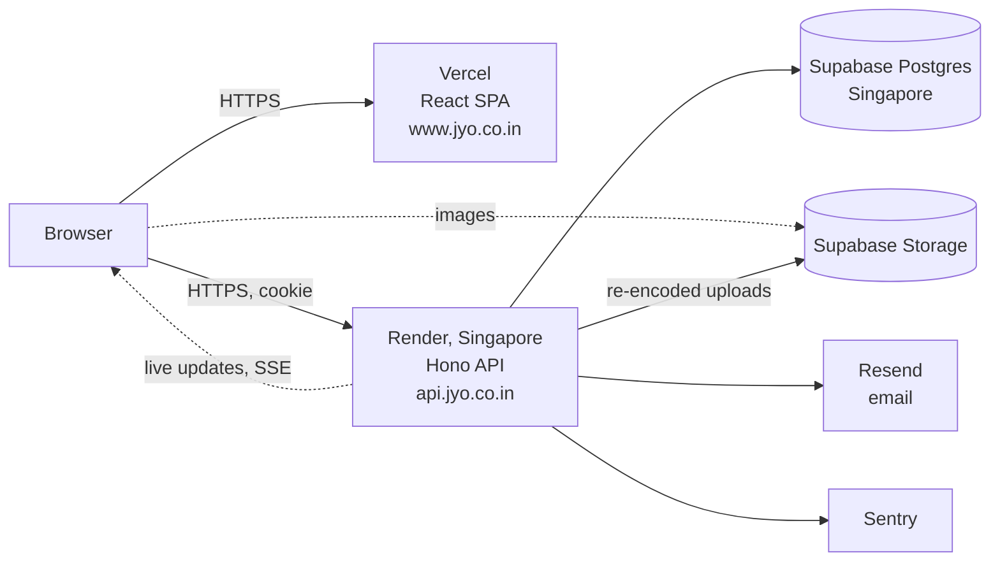

# Jyo

Free, neighbour-to-neighbour food sharing for Tirupati, India.

[](https://www.jyo.co.in)
[](https://github.com/chandan-1427/jyo/actions/workflows/ci.yml)
[](./LICENSE)

<p align="center">
  
</p>

Households often cook more than they eat, while students and neighbours a few streets away could use a meal. Jyo connects them: someone posts the food they can't finish, someone nearby asks to pick it up, and the poster says yes or no. No delivery, no payment, no middleman. It's a non-commercial project, live at **[jyo.co.in](https://www.jyo.co.in)**.

## How it works

1. **Share.** A household posts what they have, with a photo and a pickup time. Their location is taken from their phone.
2. **Ask.** People within 20 km see it in their feed. They don't see where it is or who posted it. One person asks for it, with their name, how soon they can get there, and a selfie.
3. **Meet.** The poster sees who asked and approves or declines. Only after approval does the picker see the pickup spot and the poster's name. The poster marks it collected afterwards, and unclaimed posts expire on their own. If the picker can't make it, or doesn't turn up, either side can call the pickup off and the food goes back in the feed.

Both sides get in-app notifications and email at each step. A demo mode lets anyone outside Tirupati try the whole flow with sample data.

## Built to be trusted with people's locations and photos

The app asks people to share where they live and a photo of their face, so most of the engineering is about not mishandling that.

- **Location stays hidden until it's needed.** The feed only shows distance, and the requests that load it carry coordinates rounded to about 1 km. The exact pickup spot and the poster's name go only to the poster and the one person they approved, and only until the food is collected. Phone numbers follow the same rule, and are shared only by people who choose to, one pickup at a time.
- **Photos give nothing away.** Every upload is re-encoded on the server before it's stored, which drops the metadata phone cameras embed, including the GPS position a photo was taken at. A picker's selfie is shown to no one but the poster deciding on their request.
- **Nothing identifies people across posts.** API responses list their fields explicitly, so internal account IDs never reach other users.
- **Accounts are hard to take over.** Sessions are httpOnly cookies, protected against cross-site requests, and revoked on the server at logout. Passwords use bcrypt. Email-link tokens are stored only as hashes. A password reset signs out every device.
- **Abuse is limited without locking out real people.** Many people here share one IP address, behind college Wi-Fi or mobile carriers, so tight limits are counted per account and per email address, not just per IP.
- **People can leave.** Deleting an account from the profile (after entering the password again) closes it at once: every session ends, its posts and requests disappear for everyone, and its photos and selfies are deleted. The rest is erased for good after 30 days. The same email can sign up again as a new account. It waits while someone is on their way to a pickup.
- **Unused data doesn't pile up.** Images nothing refers to any more, old notifications, revoked sessions and abandoned sign-ups are cleaned up automatically.

## Engineering highlights

For engineers and reviewers, the parts that took the most care:

- **Correct under concurrency and retries.** Every status change (approve, decline, cancel, collect) is a conditional update inside a transaction, so two simultaneous taps change the data once and notify once. Repeating an action that already happened returns the original success, so a retry after a lost response on mobile data isn't shown as an error. A re-submitted post form returns the post it already made.
- **Stable pagination.** Personal lists use keyset (cursor) pagination with integer microsecond keys. Float keys were rounded by the hosted database and repeated items at page boundaries.
- **Consistent API.** Every error is `{ error, details? }` with one status-code scheme. Input is validated with Zod at every boundary, and request bodies are size-limited before anything reads them.
- **Fast where users are.** The API runs in the same region as the database. A request that touches the database answers in about 0.2 s, down from about 1 s when they were on opposite sides of the Pacific.
- **Tested against a real database.** About 235 backend integration tests run each request through the real app and a real Postgres. They cover concurrency, idempotency, permissions (nobody can act on another user's things), CSRF, rate limits, scheduled jobs and the production-only rules. Coverage is reported in CI (about 88% of lines). The frontend has unit tests for the shared request and upload helpers.

## Architecture



- **Frontend:** React 19, React Router, TanStack Query for all server state, Tailwind CSS 4, Vite. Deployed on Vercel.
- **Backend:** Hono on Node.js, Drizzle ORM, PostgreSQL, Zod, jose (JWT), bcrypt, sharp (image processing), node-cron. One instance on Render.
- **Services:** Supabase (Postgres and Storage), Resend (email), Sentry (errors), Cloudflare (DNS), UptimeRobot (uptime).
- **Live updates:** server-sent events push new notifications and tell open feeds to refresh.

## Delivery and operations

- **Deploys only after tests pass.** GitHub Actions runs the backend tests (against a fresh Postgres) and the frontend lint, unit tests and build on every pull request. Merges to `main` then deploy automatically. The hosting platforms' own git deploys are turned off, so CI is the only way to ship.
- **Migrations run in the pipeline,** before the new code goes live. Each one must work with both the old and the new code.
- **Nightly database backups** are encrypted before they're stored, since this repository is public.
- **Monitoring:** Sentry reports unexpected errors only, never routine 4xx responses. Uptime is checked externally.
- **Supply chain:** Dependabot and CodeQL run on the repository. Advisories are checked for whether the vulnerable code is actually reachable before upgrading.

## Running it locally

You need Node.js 20+, pnpm and Docker (for the backend tests). Backend and frontend are separate packages, each with its own setup guide:

- [backend/README.md](./backend/README.md): setup, scripts, tests, environment variables
- [frontend/README.md](./frontend/README.md): setup, scripts, environment variables

```
jyo/
├── backend/   Hono API, database schema and migrations, scheduled jobs, tests
├── frontend/  React app
└── .github/   CI/CD, backups, Dependabot, CodeQL
```

## Post lifecycle

| Status | Meaning |
|---|---|
| `open` | In the feed; anyone nearby can ask for it. |
| `pending_approval` | Someone asked; the poster is deciding. Nobody else can ask meanwhile, so an unanswered request closes after 15 minutes and the post is `open` again. |
| `closed` | Approved; the picker now sees where to go. If the picker can't make it, or the poster says they didn't come, it goes back to `open` (or `expired` if the time has passed). |
| `completed` | The poster confirmed it was collected, or nobody marked it two hours after the pickup time, so it's taken as collected. |
| `expired` | The pickup time passed with nobody approved. Any waiting request is declined and the picker is told. |

## Running it for your own city

The app is city-agnostic apart from one service area:

1. Set `TIRUPATI_CENTER` and `TIRUPATI_RADIUS_KM` in `backend/src/lib/geo/haversine.ts` and `frontend/src/lib/location/geofence.ts` to your city.
2. Set your domains in `allowedOriginsFor` (`backend/src/app.ts`) and `APP_URL`.
3. Create a Supabase project with public `food-photos`, `selfies` and `avatars` buckets, and apply the migrations.
4. Change the branding and the email sender in `backend/src/lib/mailer.ts`.

## Roadmap

- A staging environment, and end-to-end browser tests against it
- Phone OTP sign-in as an alternative to email
- Chat between poster and picker after approval
- Food categories in the feed
- Trust signals for regular sharers and pickers
- A moderation dashboard
- More cities

## Contributing

Bug reports and feedback are welcome in [GitHub Issues](https://github.com/chandan-1427/jyo/issues). Code contributions aren't being taken right now, but forks are encouraged.

## License

MIT. See [LICENSE](./LICENSE).

## Author

Built by Chandan ([GitHub](https://github.com/chandan-1427)), a recent SVCE graduate who wanted to do something useful for Tirupati. Live at [jyo.co.in](https://www.jyo.co.in).
